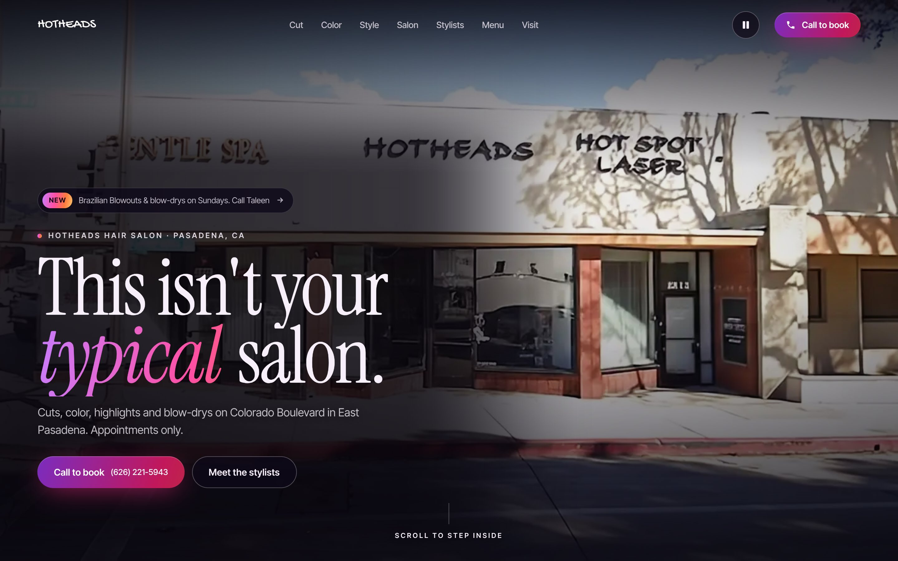
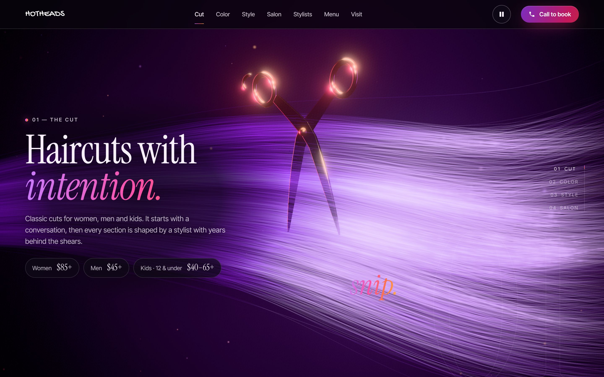
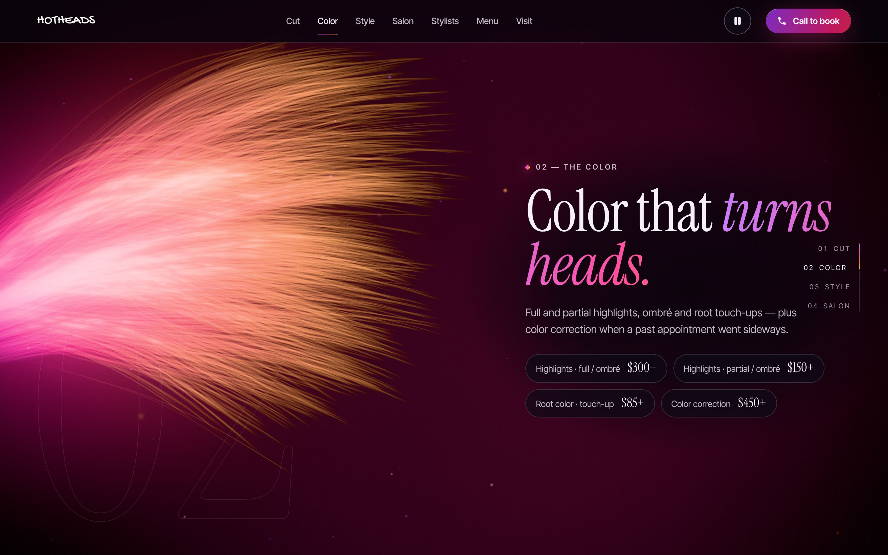
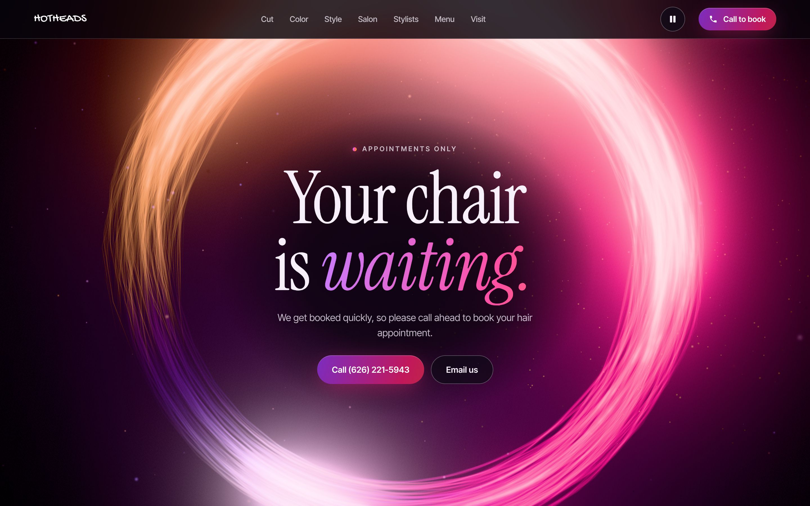

# Hotheads Salon: 3D scroll-film concept

A concept redesign of [hotheadspasadena.com](https://www.hotheadspasadena.com/) built around a
real-time 3D "film" that plays as you scroll. The live Webflow site is untouched; this is a
standalone static site you can preview, tweak and launch whenever you're ready.



| The cut | The color | The halo |
| --- | --- | --- |
|  |  |  |

## Version 2 (`/v2/`)

A second concept lives in [`v2/`](v2/) and is served at `/v2`. It's a scroll film with editorial type:

1. **The entry clip:** an 8-second AI video (Google Veo, made from a storefront still and the
   salon's interior photo), cut into 94 frames per layout (`v2/assets/film/d` landscape,
   `v2/assets/film/m` portrait). Scrolling scrubs through it: storefront, door, inside.
2. **The walk-in:** from the clip's last frame, the camera keeps moving into the real salon. This is
   the interior photo (`v2/assets/img/room.webp`) projected onto a 3D box room in WebGL, so nothing
   in it is invented. The clip's last frame is an exact crop of that photo, so the hand-off is seamless.
3. **The page:** the film shrinks into a card, then services (a swipeable card deck), stylists,
   salon photos, booking and a giant wordmark footer slide up over it.

Copy, prices and stylists are plain HTML in `v2/index.html`. The film code is in
`v2/assets/js/film.js`, and the scroll timing is in `v2/assets/js/v2.js` (`measure()`).

**Before launching V2:** the storefront in the clip comes from a Google Street View screenshot,
which is fine for a concept but not for a live site. Re-shoot the storefront (a real photo or
phone video), regenerate the clip, and re-cut the frames; put them in a new folder name so cached
frames don't linger. Then move V2 to the site root and remove its `noindex` tag.

## The film

The star of the site is a lock of hair: about 2,800 individually shaded strands rendered on the
GPU. It's inspired by the purple-haired muse painted on the salon's wall. Every chapter of the page
does something to it:

| Scroll | Chapter | What happens in 3D |
| --- | --- | --- |
| 0 | **Hero** | The purple lock flows across the screen like silk in slow motion |
| 1 | **01 · The Cut** | Rose-gold shears fly in, open, and *snip*. The cut length drops away and leaves a blunt bob |
| 2 | **02 · The Color** | Dye drops fall into the hair and a balayage paints from the tips up: violet roots, magenta mids, ember/gold ends |
| 3 | **03 · The Finish** | The lock curls into volume while heat sparks rise off it |
| 4 | **04 · The Salon** | A pinned gallery: the salon's real photos slide sideways as you scroll, each one large and sharp in the centre with a caption |
| 5–6 | Stylists / Menu | The hair settles into the background behind the content |
| 7 | **Book** | The whole lock wraps into a glowing halo around "Your chair is waiting" |
| 8 | Visit | Address, hours, contact |

Everything is driven by one number, the film position **T** (scroll position mapped through the
page's sections). Scrolling back rewinds the film: the hair un-cuts and the dye un-paints.

## Run it locally

No build step. Serve the repository root with any static file server. ES modules won't load
from `file://`, and asset URLs are root-absolute (`/assets/...`), so serve it from a domain
root, not a sub-folder:

```bash
python3 -m http.server 8080
```

Then open <http://localhost:8080>.

## Deploy (Vercel)

The repo deploys to Vercel as a static site with no framework and no build command.
`vercel.json` sets:

- **Security headers:** a strict Content-Security-Policy (no inline script except the import
  map, which is allowed by its SHA-256 hash), `nosniff`, `X-Frame-Options`, `Referrer-Policy`,
  `Permissions-Policy` and COOP.
- **Caching:** vendored libraries and fonts are cached for a year (`immutable`), images for
  30 days. JS/CSS always revalidate, so edits show up on a normal reload.
- **No indexing on `*.vercel.app`:** a host-matched `X-Robots-Tag: noindex` keeps the preview
  URL out of Google. It switches off automatically once the real domain is attached.

> **If you edit the import map in `index.html`**, recompute its hash and update the
> `script-src` in `vercel.json`, or the browser will block it:
> `python3 -c "import re,hashlib,base64;s=open('index.html').read();m=re.search(r'<script type=\"importmap\">(.*?)</script>',s,re.S);print('sha256-'+base64.b64encode(hashlib.sha256(m.group(1).encode()).digest()).decode())"`

All libraries and fonts are vendored in `assets/vendor` and `assets/fonts`, so there are no
third-party CDN calls at runtime.

## Going live on hotheadspasadena.com

1. In Vercel, add `hotheadspasadena.com` and `www.hotheadspasadena.com` to the project
   (Settings → Domains), then point DNS at Vercel as shown there.
2. Submit `https://www.hotheadspasadena.com/sitemap.xml` in Google Search Console.
3. The canonical URL, Open Graph tags, structured data and sitemap already use the `www`
   domain, so nothing in the code needs to change.

## Editing content

All copy, prices, stylists and contact details are plain HTML in `index.html`. They were carried
over from the current site:

- **Prices:** the chapter "chips" and the `#menu` section
- **Stylists:** the `#stylists` list (photo, specialty, call/text links)
- **Address / hours / email:** the `#visit` footer and the JSON-LD block in `<head>`

Photos are in `assets/img/` (optimized WebP versions of the images on the current site). The salon
gallery is the `.shots` list in the `#salon` section of `index.html`.

## Tuning the film

`assets/js/world.js` holds a keyframe list (`KEYS`). Each key sets values at a film position
`t`: camera position and target, where the hair sits, and how wavy, curly, spread out or bright it
is. Values in between are interpolated with a monotone cubic, so motion is smooth and never
overshoots. The one-off moments (the snip timing, dye drops, gallery spin) are short, commented
blocks in `update()`.

Handy knobs:

- `OPACITY_SCALE` / `BLOOM_SCALE`: overall hair brightness and glow
- hair colours: `uRootA/uMidA/uTipA` (before) and `uRootB/uMidB/uTipB` (after the dye) in `assets/js/hair.js`
- strand count: `createHair({ strands })` in `world.js` (lower automatically on phones)

## How it's built

```
index.html            semantic page; every word is real, crawlable HTML
assets/css/style.css  layout, type, scroll-linked reveals
assets/js/main.js     smooth scroll (Lenis) → film position T → DOM + 3D
assets/js/world.js    renderer, post-processing, timeline, choreography
assets/js/hair.js     GPU hair: ribbons + Kajiya-Kay sheen, cut / dye / curl / halo
assets/js/scissors.js procedural rose-gold shears (no model files)
assets/js/particles.js light dust + heat sparks
```

- **Rendering:** three.js r187 with MSAA, an HDR pipeline, bloom, a film-grain/vignette pass and neutral tone mapping
- **Performance:** fewer strands and particles on phones; quality steps down automatically if
  the frame rate drops; DPR capped at 1.75
- **Accessibility:** see below
- **SEO:** see below

## Accessibility (WCAG 2.2 AA)

The site targets WCAG 2.2 Level AA, the standard used for ADA web compliance.

- **Automated:** axe-core reports zero violations on desktop (1440×900) and phone (390×844),
  both at load and with every scroll-driven section revealed.
- **Contrast over the 3D:** axe can't measure text over a live canvas, so contrast was
  measured from rendered pixels across the whole film. For each text run, the brightest
  background behind its glyphs was compared against the text colour. Every run meets 4.5:1
  (3:1 for large text) on desktop and phone. Text sits on dark scrims that fade in with it.
- **Motion (2.2.2):** a Pause/Play button in the nav freezes all ambient motion: hair, particles
  and CSS loops. It starts paused for visitors with `prefers-reduced-motion`, which also
  turns off smooth-scroll inertia. Scroll-driven changes still follow the user.
- **Keyboard:**
  - A skip link is the first tab stop.
  - Every control is a real link or button with a visible focus ring.
  - Focused content is never left invisible mid-animation.
  - `scroll-padding` stops the sticky nav from covering focus.
  - In-page links move focus to their section.
  - The mobile menu moves focus in, makes the page behind it inert, and closes on Escape.
- **Screen readers:**
  - The 3D canvas and progress rail are decorative and hidden from assistive tech.
  - Every section is a labelled landmark under a single `h1`.
  - Call/Text buttons name the stylist and number.
  - New-tab links say so.
- **Fallbacks:** without WebGL or JavaScript the page still reads top to bottom.

Automated checks catch most, but not all, accessibility problems. Before launch, do a
quick manual pass with VoiceOver (iOS/macOS) and NVDA (Windows).

## SEO

- Keyword-bearing `<title>`, meta description and `h1` ("Hotheads hair salon · Pasadena, CA")
- Canonical URL, Open Graph and Twitter card tags with a 1200×630 share image
- JSON-LD `@graph`:
  - `HairSalon`: address, map, phone, email and price range
  - `OfferCatalog`: every service, with its starting price from the current menu
  - `employee` entries for each stylist
  - `WebSite` and `WebPage`
- `robots.txt`, an XML sitemap with image entries, a web manifest, favicons and a branded 404
- Performance: content never waits on the 3D (it fades in when ready), fonts are preloaded,
  modules are preloaded, images are lazy-loaded with fixed dimensions (no layout shift), and
  vendored assets get long-lived cache headers

## Credits

- [three.js](https://threejs.org) (MIT) and [Lenis](https://github.com/darkroomengineering/lenis) (MIT), vendored in `assets/vendor`
- Fonts: Instrument Serif and Inter Tight (SIL OFL), self-hosted from Fontsource
- Photography and logo: Hotheads Salon (from the current site)
