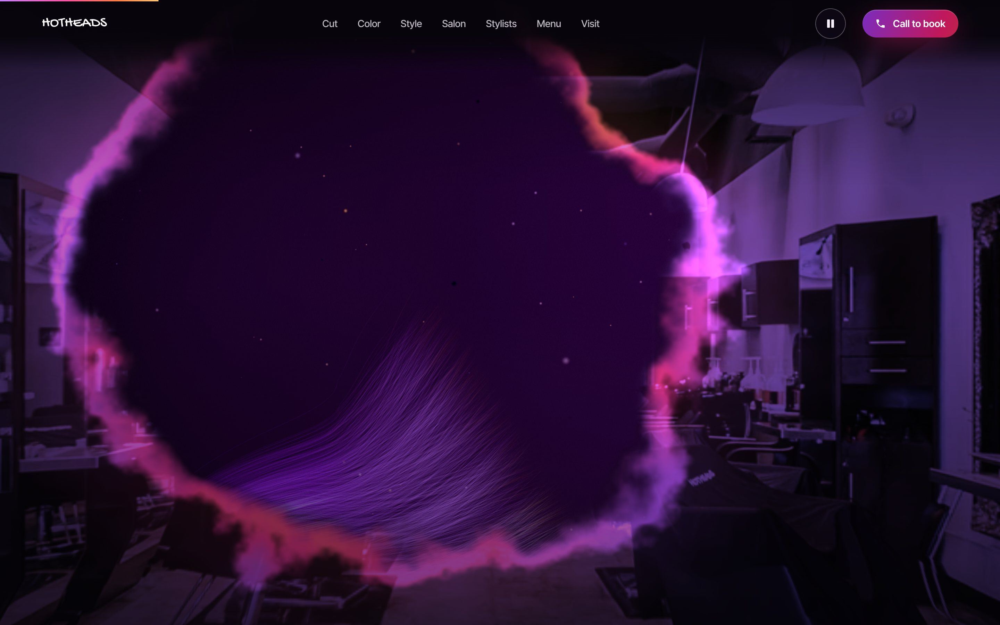

# Hotheads Salon: 3D scroll-film concept

A concept redesign of [hotheadspasadena.com](https://www.hotheadspasadena.com/) built as one
continuous film that plays as you scroll. The live Webflow site is untouched; this is a
standalone static site you can preview, tweak and launch whenever you're ready.


| The room bleeds away | The cut | The color | The halo |
| --- | --- | --- | --- |
|  |  |  |  |

## The film, in one take

The page at `/` joins the two earlier concepts into a single piece.

**Act one: the arrival** (`assets/js/film.js`)

1. **The entry clip:** an 8-second AI video (Google Veo, made from a storefront still and the
   salon's interior photo), cut into 94 frames per layout (`assets/film/d` landscape,
   `assets/film/m` portrait). Scrolling scrubs through it: storefront, door, inside.
2. **The walk-in:** from the clip's last frame, the camera keeps moving into the real salon. This is
   the interior photo (`assets/img/film/room.webp`) projected onto a 3D box room in WebGL, so nothing
   in it is invented. The clip's last frame is an exact crop of that photo, so the hand-off is seamless.
3. **The bleed:** the lights go down to violet, then the room dissolves like dye in water. The
   opening starts on the purple-haired muse on the back wall and spreads with a glowing edge,
   and the hair film is already running underneath it.

**Act two: the hair film** (`assets/js/world.js`)

The star is a lock of hair: about 2,400 individually shaded strands rendered on the GPU, inspired
by that same muse. It pours in from the corner as the room bleeds away, then every chapter does
something to it:

| Film position | Chapter | What happens in 3D |
| --- | --- | --- |
| 0 | **Welcome** | The purple lock grows out across the screen and flows like silk in slow motion |
| 1 | **01 · The Cut** | Rose-gold shears fly in, open, and *snip*. The cut length drops away and leaves a blunt bob |
| 2 | **02 · The Color** | Dye drops fall into the hair and a balayage paints from the tips up: violet roots, magenta mids, ember/gold ends |
| 3 | **03 · The Finish** | The lock curls into volume while heat sparks rise off it |
| 4 | **04 · The Salon** | A pinned gallery: the salon's real photos slide sideways as you scroll, each one large and sharp in the centre with a caption |
| 5–6 | Stylists / Menu | The hair settles into the background behind the content |
| 7 | **Book** | The whole lock wraps into a glowing halo around "Your chair is waiting" |
| 8 | Visit | Address, hours, contact |

Both acts are driven by scroll position alone, so scrolling back rewinds everything: the hair
un-cuts, the dye un-paints, the room re-forms and you back out of the door.

The two layers are separate canvases. While the opening film covers the screen the hair world is
not drawn at all, and it only starts loading once the opening has settled, so the first paint
never waits on three.js. Far down the page the clip's frames are released from memory and come
back from the browser cache on the way up.

### Before launching

The storefront in the clip comes from a Google Street View screenshot, which is fine for a concept
but not for a live site. Re-shoot the storefront (a real photo or phone video), regenerate the
clip, and re-cut the frames into a new folder name (so cached frames don't linger), then point
`SETS` in `assets/js/film.js` at it and replace `assets/img/film/poster-*.webp`.

### The earlier concepts

Both originals are kept for comparison, each self-contained and marked `noindex`:

- [`/v1`](v1/): the hair film on its own
- [`/v2`](v2/): the storefront film with an editorial page under it

They share the fonts, photos, film frames and vendored libraries in `/assets`. Delete the `v1/`
and `v2/` folders whenever you no longer need them; nothing at the site root depends on them.

## Pace: how fast the film plays

The whole site is tuned to play slowly. Three things set the pace:

| Where | What | Slower = |
| --- | --- | --- |
| `assets/js/main.js` | `WHEEL_PACE` (0.58): how far one notch of a mouse wheel or trackpad travels, as a fraction of the browser default. `WHEEL_GLIDE` is how softly it comes to rest | lower |
| `assets/js/main.js` | `FOLLOW`: how quickly the pictures catch up with the scroll position (softer on touch, so a fast flick plays out as a smooth move) | lower |
| `assets/css/style.css` | Section heights: `.beat*` (the opening film) and `.chapter` (the hair film). The touch-screen values are in the `(pointer: coarse)` block | taller |

Touch screens deliberately keep the browser's own scrolling. Scripted touch scrolling was tried
earlier and caused jumps on iOS, so on phones the film is slowed by distance (taller sections)
and the softer follow, not by fighting the finger.

## Run it locally

No build step. Serve the repository root with any static file server. ES modules won't load
from `file://`, and asset URLs are root-absolute (`/assets/...`), so serve it from a domain
root, not a sub-folder:

```bash
python3 -m http.server 8080
```

Then open <http://localhost:8080>.

## Deploy (Vercel)

The repo deploys to Vercel as a static site with no framework and no build command.
`vercel.json` sets:

- **Security headers:** a strict Content-Security-Policy (no inline script except the import
  map, which is allowed by its SHA-256 hash), `nosniff`, `X-Frame-Options`, `Referrer-Policy`,
  `Permissions-Policy` and COOP.
- **Caching:** vendored libraries and fonts are cached for a year (`immutable`), images for
  30 days. JS/CSS always revalidate, so edits show up on a normal reload.
- **No indexing on `*.vercel.app`:** a host-matched `X-Robots-Tag: noindex` keeps the preview
  URL out of Google. It switches off automatically once the real domain is attached.

> **If you edit the import map in `index.html`**, recompute its hash and update the
> `script-src` in `vercel.json`, or the browser will block it:
> `python3 -c "import re,hashlib,base64;s=open('index.html').read();m=re.search(r'<script type=\"importmap\">(.*?)</script>',s,re.S);print('sha256-'+base64.b64encode(hashlib.sha256(m.group(1).encode()).digest()).decode())"`

All libraries and fonts are vendored in `assets/vendor` and `assets/fonts`, so there are no
third-party CDN calls at runtime.

## Going live on hotheadspasadena.com

1. In Vercel, add `hotheadspasadena.com` and `www.hotheadspasadena.com` to the project
   (Settings → Domains), then point DNS at Vercel as shown there.
2. Submit `https://www.hotheadspasadena.com/sitemap.xml` in Google Search Console.
3. The canonical URL, Open Graph tags, structured data and sitemap already use the `www`
   domain, so nothing in the code needs to change.

## Editing content

All copy, prices, stylists and contact details are plain HTML in `index.html`. They were carried
over from the current site:

- **Opening film copy:** the `.beat` blocks inside `.reel` (headline, "Come on in", "The floor", "Welcome")
- **Prices:** the chapter "chips" and the `#menu` section
- **Stylists:** the `#stylists` list (photo, specialty, call/text links)
- **Address / hours / email:** the `#visit` footer and the JSON-LD block in `<head>`

Photos are in `assets/img/` (optimized WebP versions of the images on the current site). The salon
gallery is the `.shots` list in the `#salon` section of `index.html`.

## Tuning the film

**The opening film.** `measureReel()` in `assets/js/main.js` places its moments relative to the
copy blocks: where the clip ends, where the lights go down and where the bleed starts and
finishes. In `assets/js/film.js`, `DOLLY` is how far the camera walks into the room, `MX`/`MY`
is the point in the photo the bleed opens from, and the look of the bleed (edge, glow colours,
the violet "lights down" grade) is the short block at the end of `ROOM_FS`.

**The hair film.** `assets/js/world.js` holds a keyframe list (`KEYS`). Each key sets values at a film position
`t`: camera position and target, where the hair sits, and how wavy, curly, spread out or bright it
is. Values in between are interpolated with a monotone cubic, so motion is smooth and never
overshoots. The one-off moments (the snip timing, dye drops, gallery spin) are short, commented
blocks in `update()`.

Handy knobs:

- `OPACITY_SCALE` / `BLOOM_SCALE`: overall hair brightness and glow
- hair colours: `uRootA/uMidA/uTipA` (before) and `uRootB/uMidB/uTipB` (after the dye) in `assets/js/hair.js`
- strand count: `createHair({ strands })` in `world.js` (lower automatically on phones)

## How it's built

```
index.html            semantic page; every word is real, crawlable HTML
assets/css/style.css  layout, type, scroll-linked reveals
assets/js/main.js     smooth scroll (Lenis) → both films + DOM
assets/js/film.js     opening film: clip frames, 3D walk-in, the bleed (plain WebGL2, no library)
assets/js/world.js    hair world: renderer, post-processing, timeline, choreography
assets/js/hair.js     GPU hair: ribbons + Kajiya-Kay sheen, cut / dye / curl / halo
assets/js/scissors.js procedural rose-gold shears (no model files)
assets/js/particles.js light dust + heat sparks
```

- **Rendering:** three.js r187 with MSAA, an HDR pipeline, bloom, a film-grain/vignette pass and neutral tone mapping
- **Performance:** the hair world loads after the opening film and is not drawn while that
  film covers it; fewer strands and particles on phones; quality steps down automatically if
  the frame rate drops; resolution capped per screen size
- **Accessibility:** see below
- **SEO:** see below

## Accessibility (WCAG 2.2 AA)

The site targets WCAG 2.2 Level AA, the standard used for ADA web compliance.

- **Automated:** axe-core reports zero violations on desktop (1440×900) and phone (390×844),
  both at load and with every scroll-driven section revealed.
- **Contrast over the films:** axe can't measure text over a live canvas, so contrast was
  measured from rendered pixels. For each text run, the brightest background behind it was
  compared against the text colour. Every run meets 4.5:1 (3:1 for large text). The opening
  film, bleed and welcome were measured at 2000×1100, 1440×900 and 390×844 (0 failures;
  body text never below 5.5:1); the hair chapters were measured the same way when they were
  built. Text sits on dark, feathered scrims that fade in with it.
- **Motion (2.2.2):** a Pause/Play button in the nav freezes all ambient motion: hair, particles
  and CSS loops. It starts paused for visitors with `prefers-reduced-motion`, which also
  turns off smooth-scroll inertia. Scroll-driven changes still follow the user.
- **Keyboard:**
  - A skip link is the first tab stop.
  - Every control is a real link or button with a visible focus ring.
  - Focused content is never left invisible mid-animation.
  - `scroll-padding` stops the sticky nav from covering focus.
  - In-page links move focus to their section.
  - The mobile menu moves focus in, makes the page behind it inert, and closes on Escape.
- **Screen readers:**
  - The 3D canvas and progress rail are decorative and hidden from assistive tech.
  - Every section is a labelled landmark under a single `h1`.
  - Call/Text buttons name the stylist and number.
  - New-tab links say so.
- **Fallbacks:** without WebGL or JavaScript the page still reads top to bottom (the opening
  film becomes a still behind the headline, and its copy closes up into stacked sections).

Automated checks catch most, but not all, accessibility problems. Before launch, do a
quick manual pass with VoiceOver (iOS/macOS) and NVDA (Windows).

## SEO

- Keyword-bearing `<title>`, meta description and `h1` ("Hotheads hair salon · Pasadena, CA")
- Canonical URL, Open Graph and Twitter card tags with a 1200×630 share image
- JSON-LD `@graph`:
  - `HairSalon`: address, map, phone, email and price range
  - `OfferCatalog`: every service, with its starting price from the current menu
  - `employee` entries for each stylist
  - `WebSite` and `WebPage`
- `robots.txt`, an XML sitemap with image entries, a web manifest, favicons and a branded 404
- Performance: content never waits on the 3D (three.js loads after the opening has settled),
  fonts and the first film frame are preloaded, the film's frames load coarse to fine so it
  is scrubbable early, images are lazy-loaded with fixed dimensions (no layout shift), and
  vendored assets get long-lived cache headers

## Credits

- [three.js](https://threejs.org) (MIT) and [Lenis](https://github.com/darkroomengineering/lenis) (MIT), vendored in `assets/vendor`
- Fonts: Instrument Serif and Inter Tight (SIL OFL), self-hosted from Fontsource
- Photography and logo: Hotheads Salon (from the current site)
